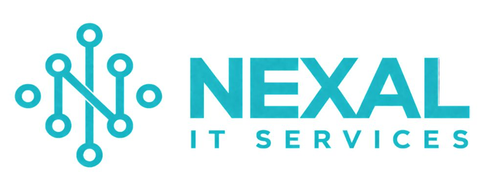
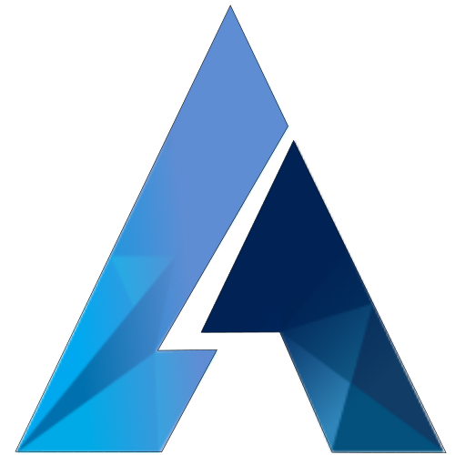
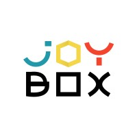
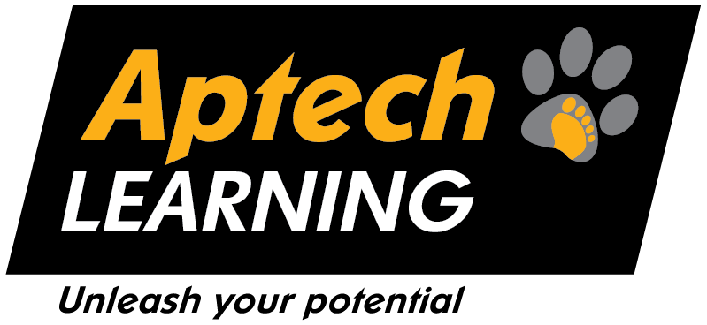

 

 

  

### Full-Stack Developer · AI/ML Enthusiast · Mobile App Developer

Building reliable web & mobile products with **Laravel / PHP**, **Next.js / React**, **Flutter / Dart**, **Node.js**, **REST APIs**, and cloud deployments.

 

 

 

---

## 📊 Developer Snapshot

| 🚀 Projects | 🧰 Tech Stacks | 🎓 Education | 💼 Current Role | 📍 Location |
|:---:|:---:|:---:|:---:|:---:|
| **30+** | **15+** | **BSCM + ADSE** | **Full-Stack @ Kloz Labs** | **Karachi, Pakistan 🇵🇰** |

---

## 🔗 Quick Navigation

---

# 👨‍💻 About Me

I'm **Rayyan Hassan**, a Full-Stack Software Developer from **Pakistan 🇵🇰** focused on building reliable, scalable web and mobile applications. I work across backend, frontend, and mobile — choosing the right tools and architecture for each product rather than limiting solutions to a single stack.

My core toolkit spans **Laravel & PHP**, **Next.js & React**, **Flutter & Dart**, **Node.js**, and **REST APIs**. I enjoy turning real-world requirements into maintainable systems, thoughtful user experiences, and dependable integrations — from database design and APIs to responsive interfaces, mobile apps, CI/CD, and cloud deployment on **AWS** and similar platforms.

---

# 💼 Experience

> Synced from my portfolio — real roles across full-stack, mobile, and frontend development.

<table>
<tr>
<td width="72" valign="top">

</td>
<td>

### [Kloz Labs](https://www.klozlabs.com/) — Full-Stack Developer
**Present** · Karachi, Pakistan (Remote) · `Current`

Working end-to-end on web and mobile apps with **Laravel**, **Flutter**, and **Dart** — UI, backend APIs, databases, deployment, and maintenance.

`Laravel` · `PHP` · `Flutter` · `Dart` · `REST APIs` · `Database Management` · `Laragon` · `Git`

</td>
</tr>

<tr>
<td width="72" valign="top">

</td>
<td>

### [Nexal IT Services](https://nexalitservices.com/) — Full-Stack Developer (MERN & MEAN)
**Feb 2026** · Full-Time · Karachi, Pakistan (Onsite)

Built scalable web apps across **MERN** and **MEAN** stacks — React/Angular frontends, Node/Express APIs, MongoDB/MySQL, and cloud basics.

`MongoDB` · `Express` · `React` · `Angular` · `Node.js` · `MySQL` · `REST APIs` · `AWS` · `Git`

 

### Nexal IT Services — Full-Stack Developer (Internship)
**Nov 2025 – Feb 2026** · Internship · Karachi, Pakistan (Onsite)

Hands-on internship on real-world web apps across frontend and backend.

`HTML` · `CSS` · `JavaScript` · `React.js` · `Node.js` · `PHP` · `MySQL` · `MongoDB` · `Git`

</td>
</tr>

<tr>
<td width="72" valign="top">

</td>
<td>

### [Anomoz Softwares](https://www.anomoz.com/) — PHP Developer (Internship)
**Dec 2024** · Internship · Karachi, Pakistan (Onsite)

PHP-focused internship on collaborative full-stack web applications.

`PHP` · `HTML` · `CSS` · `JavaScript` · `React.js` · `Node.js` · `MySQL` · `MongoDB` · `Git`

</td>
</tr>

<tr>
<td width="72" valign="top">

</td>
<td>

### [JoyBox Pakistan](https://www.linkedin.com/company/jbbox/posts/?feedView=all) — Junior Front-End Developer (Internship)
**Feb 2024 – April 2024** · Paid Internship · Karachi, Pakistan (Onsite)

3-month paid internship focused on responsive UI implementation and modern frontend workflows in Agile teams.

`HTML` · `CSS` · `JavaScript` · `Bootstrap` · `Tailwind CSS` · `Material-UI` · `Git`

</td>
</tr>
</table>

---

# 🎓 Education

<table>
<tr>
<td width="72" valign="top">

</td>
<td>

### Bachelor of Computational Mathematics (BSCM)
**University of Karachi** · 2026 – Present · `In Progress` · Graduation Degree

Building a blend of mathematical logic, scientific computing, and software skills — Python, C++, algorithms, numerical analysis, data science, and ML foundations.

`Python` · `C++` · `DSA` · `OOP` · `Scientific Computing` · `Numerical Analysis` · `Data Science` · `Machine Learning` · `AI`

</td>
</tr>

<tr>
<td width="72" valign="top">

</td>
<td>

### Advanced Diploma in Software Engineering (ADSE)
**Aptech Learning** · 2023 – 2026 · `Completed` · Professional Diploma  
ACCP AI Career Program — Full-Stack, Mobile & AI Engineering

Completed the ACCP AI Career Program covering full-stack web, Flutter apps, databases, Azure cloud, and applied AI/ML with Python.

`JavaScript` · `TypeScript` · `React` · `Node.js` · `MERN` · `PHP` · `Laravel` · `C#` · `.NET` · `Flutter` · `Python` · `MySQL` · `MongoDB` · `Azure` · `ML` · `NLP`

</td>
</tr>

<tr>
<td width="72" valign="top">

</td>
<td>

### HSSC (Computer Science)
**Siraj-Ul-Daulah Government Degree College** · 2023 – 2025 · `Completed`

Foundation of programming logic and mathematical foundations of computing.

`C++` · `Data Structures` · `Logic Building`

</td>
</tr>

<tr>
<td width="72" valign="top">

</td>
<td>

### SSC (Computer Science)
**Quaid-e-Azam Rangers School** · 2021 – 2023 · `Completed`

Initial exposure to computer science fundamentals and problem-solving.

`Computer Basics` · `Algorithms` · `Mathematics`

</td>
</tr>
</table>

---

# 🛠️ Skills & Technologies

> A curated set of technologies I use to build scalable, modern, secure, and high-performance applications.

## 💻 Languages

## 🎨 Frontend

`Chart.js` · `Recharts` · `PWA` · `SEO / Meta Tags` · `Webpack` · `Vite` · `Responsive UI` · `Accessibility` · `UI/UX` · `Lucide React`

## ⚙️ Backend & APIs

`REST APIs` · `Next.js API Routes` · `Microservices` · `Webhooks` · `Rate Limiting` · `Swagger / OpenAPI`

## 🗄️ Database & Caching

`Mongoose` · `TypeORM` · `Schema Design` · `Query Optimization`

## 🤖 AI / Machine Learning

`Machine Learning` · `Data Processing` · `Generative AI` · `Prompt Engineering` · `AI Image Generation` · `AI Video Generation`

## 📊 Data & BI

`Data Visualization` · `Business Intelligence` · `Dashboards`

## ☁️ DevOps, Cloud & Tools

`CI/CD` · `Linux Server` · `PM2` · `Railway` · `Render` · `Netlify` · `Hostinger VPS` · `Postman` · `Cloudinary`

## 📱 Mobile

`GetX` · `Bloc` · `Push Notifications` · `Deep Linking` · `App Store / Play Store Publishing` · `Cross-Platform`

## 🔐 Auth, Security & Testing

`OAuth 2.0` · `RBAC` · `2FA` · `Zod` · `OWASP Basics` · `Helmet` · `React Testing Library`

## 💳 Payments & Integrations

`JazzCash` · `EasyPaisa` · `Invoice Systems` · `Multi-tenant Apps` · `Gmail API` · `Notion API` · `Slack Webhooks` · `WhatsApp Cloud API` · `Resend`

## 🤝 Soft Skills

`Problem-Solving` · `Debugging` · `Adaptability` · `Communication` · `Teamwork` · `Ownership` · `Quick Learner` · `Code Review` · `Client Communication` · `Requirement Gathering` · `Documentation`

---

# 🚀 Featured Projects

## 🌍 Global Business Partners — `Live` · Monorepo Suite

Monorepo suite covering public website, admin panel, vendor portal, and startup app from a shared application base.

**Stack:** `Web App` · `Dashboard` · `Vendor Portal` · `Startup Portal` · `Monorepo`  
🔗 [Live Site](https://digitalpakistangroup.com/)

## 🌎 EarthScape Climate Agency — `AI + ML`

AI-powered climate awareness platform with ML models, predictions, and interactive dashboards.

**Stack:** `Python` · `Flask` · `Machine Learning` · `HTML` · `CSS` · `JavaScript`  
🔗 [GitHub](https://github.com/RAYYANHASSAN321/EarthScape-Climate-Agency) · [Live](https://earth-scape-climate-agency.vercel.app/)

## 🏢 Nexal IT Services Web App — `Live`

Corporate digital services website for web & app development, AI solutions, marketing, and e-commerce.

🔗 [Live Site](https://nexalitservices.com/)

## ✨ RenewMe Wellness Platform — `Live`

Wellness platform with guided meditations, mood tracking, and partner experiences.

🔗 [Live Site](https://myrenewme.com/)

## ✈️ TravelApp & Chemi Travels — `Live`

Full travel platforms covering hotels, tickets, packages, visas, and booking journeys.

🔗 [TravelApp](https://travel-app-frontend-snowy.vercel.app/) · [Chemi Travels](https://chemitravels.com/)

---

# 📱 Additional Projects

<strong>🏨 LuxuryStay Hotel Management System</strong>

 

Full-stack hotel management for rooms, customers, staff, reservations, and billing with Admin / Staff / Customer roles.

**Tech:** `PHP` · `MySQL` · `HTML` · `CSS` · `Bootstrap`  
🔗 [GitHub](https://github.com/RAYYANHASSAN321/HMS)

<strong>🐾 PawfectCare</strong>

 

Cross-platform pet-care mobile app — profiles, care tracking, reminders. Team of 4.

**Tech:** `Flutter` · `Dart` · `Firebase` · `Firestore`  
🔗 [GitHub](https://github.com/donatedsalt/PawfectCare)

<strong>💰 TripBudgeter</strong>

 

Collaborative travel budgeting app for trip planning and group expenses.

**Tech:** `Flutter` · `Dart` · `Firebase`  
🔗 [GitHub](https://github.com/donatedsalt/TripBudgeter)

<strong>🗺️ Citi Guide</strong>

 

City exploration app with listings, filters, favorites, and map navigation.

**Tech:** `Flutter` · `Dart` · `Firebase` · `Google Maps`  
🔗 [GitHub](https://github.com/RAYYANHASSAN321/Citi_Guide)

<strong>🅿️ Smart-Park</strong>

 

Smart parking app with real-time availability, GPS booking, and reservations.

**Tech:** `Flutter` · `Dart` · `Firebase` · `Google Maps API`  
🔗 [GitHub](https://github.com/RAYYANHASSAN321/Smart-Park)

<strong>🚑 Rapid Rescue</strong>

 

Emergency-response web app with auth, request tracking, and admin panel.

**Tech:** `PHP` · `MySQL` · `HTML` · `CSS` · `Bootstrap`  
🔗 [GitHub](https://github.com/RAYYANHASSAN321/Rapid-Rescue)

<strong>📅 Online Reservation System</strong>

 

Reservation platform with auth, CRUD bookings, and admin dashboard.

**Tech:** `PHP` · `MySQL` · `HTML` · `CSS`  
🔗 [GitHub](https://github.com/RAYYANHASSAN321/Online-Reservation-System)

<strong>💄 Online Cosmetics Web Application</strong>

 

E-commerce for beauty products — listings, cart, checkout, and admin dashboard.

**Tech:** `PHP` · `MySQL` · `HTML` · `CSS`  
🔗 [GitHub](https://github.com/RAYYANHASSAN321/COSMETICS_WEB_APP)

<strong>🌐 More Live Client Sites</strong>

 

- [Web Development Wizards](https://webdevelopmentwizards.com/)
- [Voltrix Publishers](https://voltrixpublishers.com/)
- [Website Yard](https://websiteyard.com/)
- [eBooks Studio](https://ebooksstudio.com/)
- [RenewMe Affiliate Dashboard](https://affiliate.myrenewme.com/auth/login)
- [Attendance Tracking App](https://nexal-attendance-app.vercel.app/)

---

# 🏆 Certificates & Recognition

| Certificate | Issuer | Year |
|---|---|---|
| 🛡️ Introduction to Cybersecurity | Cisco Networking Academy | 2026 |
| 🥇 TechWiz5 APTECH Techa Event | APTECH Learning / Plexus Programmers | 2024 |
| 💻 Full-Stack Developer Internship Completion | Nexal IT Services | 2026 |
| 🎨 Junior Frontend Developer Internship | JoyBox Pakistan | 2024 |
| 📘 Google Soft Skills Certification | Google | 2024 |
| 🌱 Personality Development & Self-Discovery | EasyLife | 2025 |
| 🗣️ Personality Development Course | Growbiz Network | 2025 |

---

# 🐍 Contribution Snake

---

# 📬 Get In Touch

Open to roles and collaborations as a **full-stack**, **web**, **backend**, or **mobile** developer.

 

| 📧 Email | 📱 Phone / WhatsApp | 📍 Location |
|:---:|:---:|:---:|
| [rayyanhassan1688@gmail.com](mailto:rayyanhassan1688@gmail.com) | [+92-349-1833008](tel:+923491833008) | Karachi, Pakistan 🇵🇰 |
| [rayyanhasan571@gmail.com](mailto:rayyanhasan571@gmail.com) | [WhatsApp](https://wa.me/923491833008) | |

 

---

  

### ⚡ Build. Learn. Improve. Repeat.

*"Code is poetry, and I strive to write verses that make a difference."*

 

**Rayyan Hassan** · Full-Stack Developer

[Portfolio](https://rayyanhassan.runs-on.dev/) ·
[GitHub](https://github.com/RAYYANHASSAN321) ·
[LinkedIn](https://pk.linkedin.com/in/rayyanhasn) ·
[Contact](https://rayyanhassan.runs-on.dev/contact)

 

© 2026 Rayyan Hassan · All Rights Reserved

 

